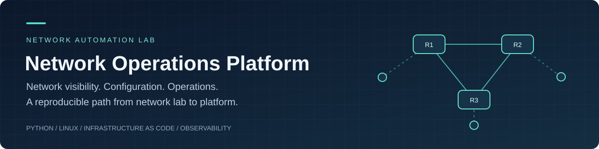
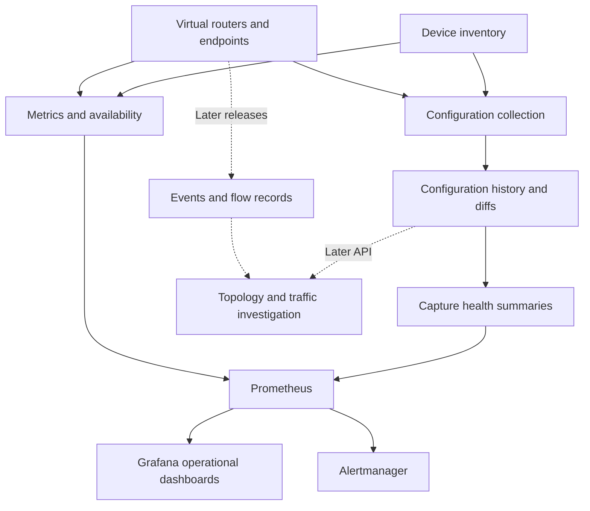

  

# Network Operations Platform

**A SolarWinds-inspired platform for network visibility, configuration management, and operations.**

Build a virtual network, discover and document its devices, monitor its health, track configuration changes, analyze traffic, and investigate failures from a coherent operational view. This project combines original software with established infrastructure tools and develops the delivery and operating practices expected in platform engineering.

**Current stage:** documentation and design. The application and virtual lab have not been implemented. This repository establishes the requirements, architecture, and delivery plan.

[Documentation](docs/README.md) · [SolarWinds capability map](docs/solarwinds-capability-map.md) · [Dependency roadmap](docs/roadmap.md) · [Virtual network lab](docs/lab/virtual-network-lab.md)

## What we are building

| Capability | Intended experience |
| --- | --- |
| **Inventory and topology** | Know which devices exist, their roles, and how they connect |
| **Health and performance** | See availability, latency, interfaces, errors, and stale observations |
| **Configuration management** | Capture history, inspect changes, and evaluate explicit configuration policies |
| **Alerts and investigation** | Receive actionable alerts and review metrics, changes, and events together |
| **Traffic analysis** | Identify top endpoints and conversations from supported flow records |
| **Address and endpoint visibility** | Reconcile intended inventory/address space with observed devices and ports |
| **Platform delivery** | Rebuild, test, deploy, observe, and recover the system through repeatable workflows |

SolarWinds is the capability reference. This is an independent implementation with a staged scope, not an affiliated product or a claim of full feature parity. See the [researched capability map](docs/solarwinds-capability-map.md) for the detailed comparison.

## Platform at a glance

This is a design diagram. Solid connections form the first usable platform release; dashed connections describe expansion.

## Build sequence

| Milestone | Outcome | Evidence required |
| --- | --- | --- |
| **Engineering foundation** | One lab router and a complete configuration capture/diff path | Manual comparison, known-change test, preserved baseline on failure |
| **v0.1.0 — integrated platform** | Three-router inventory, scheduled captures, health monitoring, dashboards, and alerts | Fresh lab rebuild, change/outage/recovery demonstration |
| **v0.2.0 — investigation** | Read API, structured history, syslog correlation, and lab policy checks | Access-control tests, restore test, incident walkthrough |
| **v0.3.0 — network intelligence** | Observed topology, flow analysis, address/inventory integration, endpoint mapping | Controlled traffic and topology tests with explicit limitations |
| **v0.4.0 — platform delivery** | Repeatable provisioning, release artifacts, recovery, and optional Kubernetes/GitOps deployment | Clean deployment, rollback, measured operational results |

The one-router milestone is the first engineering slice. **The first usable product includes monitoring and operations as well as configurations.** Versions are targets; the [roadmap](docs/roadmap.md) owns task status and dependencies.

## Platform engineering focus

Python and Linux provide the foundation. Containerlab and FRRouting create the network. Prometheus, Grafana, and Alertmanager provide telemetry and alert routing. GitHub Actions, automated tests, dependency locks, infrastructure as code, and runbooks make the system reproducible and operable.

Later tools enter for specific reasons: FastAPI for the service contract, NetBox for intended inventory, Ansible for configuration, OpenTofu for supported infrastructure provisioning, and Kubernetes/GitOps for deployment practice. The [technology strategy](docs/technology-strategy.md) explains these choices and their tradeoffs.

## Explore the project

- **Understand the goal:** [project brief](docs/project-brief.md) and [architecture](docs/architecture.md).
- **Resume development:** [current checkpoint](docs/project-status.md), [dependency roadmap](docs/roadmap.md), and [contribution workflow](CONTRIBUTING.md).
- **Build the network:** [lab host, topology, isolation, and setup plan](docs/lab/virtual-network-lab.md).
- **Verify behavior:** [requirements](docs/requirements.md), [test strategy](docs/testing-strategy.md), and [lab scenarios](docs/lab/test-scenarios.md).
- **Review the eventual demonstration:** [portfolio evidence guide](docs/portfolio-demo.md).

There is no application installation command yet. This initial repository contains documentation and project configuration. Python packaging, source code, automated tests, synthetic fixtures, and executable lab definitions will be added as their roadmap tasks are implemented.

## Operating boundaries

The default environment is an isolated lab with synthetic data. A workplace pilot is optional and has a separate [production gate](docs/operations/production-pilot.md). Device configuration writes and unattended remediation are outside the current plan.

This checkout is in a OneDrive-synced directory. **Real configurations and credentials must use an approved location outside this tree**, even if Git ignores them. See [security and data handling](docs/security.md).

**License:** not selected. Before publication as an open-source project, record the owner's license choice. No test results, release badges, screenshots, or performance claims will be presented as achieved until evidence exists.
