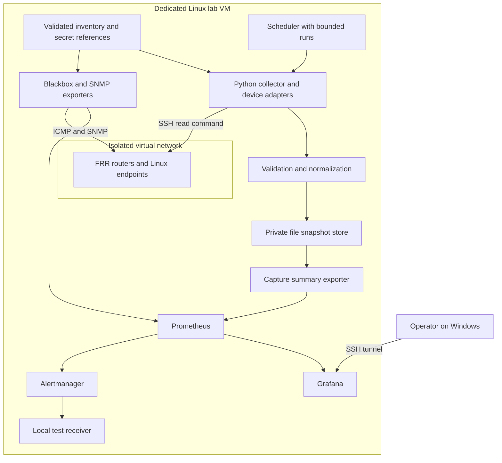

# Platform architecture

**Status:** proposed implementation, 2026-09-28. The design describes a network operations platform. None of these services is deployed yet.

## Architectural direction

Start with a modular Python application for configuration collection and inventory. Integrate mature monitoring services around it. Keep the capture and comparison domain independent from the CLI, scheduler, and later API so each interface can reuse tested behavior.

A small Compose deployment inside the Linux lab VM is the first service environment. Containerlab owns virtual network nodes and links. The monitoring services observe that network through an explicitly controlled management path.

## First usable platform



The operator can inspect configuration diffs through the CLI during v0.1. Grafana shows capture metadata and health summaries, not raw configuration text. A richer authenticated history view enters with the API milestone.

## Component responsibilities

| Component | Owns | Must not do |
| --- | --- | --- |
| Inventory loader | Schema validation, stable IDs, target allowlist, credential references | Accept arbitrary commands from inventory |
| Credential provider | Resolve runtime secret references | Print secrets or persist them in run metadata |
| Device adapter | Connection lifecycle, fixed read operation, transport cleanup, platform validation | Hide command errors or accept arbitrary shell execution |
| Capture service | Per-device lock, run state, time budget, retry classification | Promote a failed or unvalidated capture |
| Snapshot repository | Immutable raw/normalized payloads, hashes, metadata, atomic publication | Mix device/environment histories |
| Comparison service | Compatible-baseline selection and deterministic line diff | Treat a detected change as unauthorized or causative |
| Summary exporter | Bounded labels, latest attempt/success/change, failure counts | Export configs, diffs, credentials, or unbounded run-ID labels |
| Monitoring stack | Polls, time series, dashboards, alert state | Treat missing observations as zero or healthy |

## Capture transaction

```mermaid
sequenceDiagram
    participant Job as CLI or scheduler
    participant Core as Capture service
    participant Device as Lab device
    participant Store as Snapshot repository
    Job->>Core: Validated device and run context
    Core->>Store: Acquire per-device lock
    Core->>Device: Verify host key and run fixed read command
    Device-->>Core: Output or classified error
    alt Capture passes adapter validation
        Core->>Core: Preserve raw bytes and normalize comparison text
        Core->>Store: Stage payloads and metadata on same filesystem
        Core->>Store: Atomically publish complete snapshot directory
        Core->>Store: Atomically advance baseline pointer
        Core-->>Job: Baseline, unchanged, or changed result
    else Capture fails
        Core->>Store: Record safe failure metadata only
        Core-->>Job: Failed result; previous baseline preserved
    end
    Core->>Store: Release lock
```

A crash after directory publication but before pointer update must be recoverable by enumerating complete snapshots and reconciling the pointer under lock. Staging directories never count as successful snapshots. The implementation must test filesystem behavior on the supported runtime; atomic rename alone does not establish power-loss durability.

## Data and trust boundaries

- The **public repository** contains source, templates, synthetic fixtures, and reviewed evidence.
- The **runtime secret store** supplies SSH/SNMP credentials. Public CI receives none of the lab or workplace secrets.
- The **private configuration store** contains sensitive captures and diffs. It is separate from Git, metrics, and logs.
- The **management network** permits only the collectors and authorized operator paths to reach device management services.
- The **data plane** carries synthetic routed traffic. It has no uplink to a real network.
- The **future API** authorizes configuration access by device/environment. Dashboard access alone does not grant config-download access.

NAT does not enforce these boundaries by itself. See [lab isolation](lab/virtual-network-lab.md) and [security](security.md).

## Failure and concurrency model

Begin with one device and a single process. Expand to at most three concurrent device jobs in the reference lab, with one active capture per device. Set a total device budget as well as connect/read timeouts. Retry only classified transient failures once with backoff; never retry authentication or host-key failures automatically.

Each device returns its own result. A partial run has a nonzero exit status and still includes successful results. A scheduler records start, finish, duration, skipped work, and next expected attempt. Capture freshness uses the last successful capture, while collector liveness uses the most recent heartbeat.

Metric queries distinguish exporter reachability (`up`), probe outcome (`probe_success` where applicable), device measurements, and missing series. An exporter being alive is not proof that its target is healthy. The [Prometheus multi-target exporter guide](https://prometheus.io/docs/guides/multi-target-exporter/) describes this collection pattern.

## Expansion architecture

| Release | Addition | Integration boundary |
| --- | --- | --- |
| v0.2 | FastAPI and PostgreSQL metadata | Keep configuration payloads in private storage; database stores references, identities, runs, and events |
| v0.2 | Syslog and configuration policy engine | Normalize events, preserve raw provenance privately, and attach explicit rule versions |
| v0.3 | LLDP topology observations | Retain last-seen and confidence/ambiguity; compare against declared wiring |
| v0.3 | Flow collection | Dedicated ingest/storage path; do not put arbitrary endpoint pairs into Prometheus labels |
| v0.3 | NetBox integration | NetBox owns intended inventory when enabled; observations never silently overwrite intent |
| v0.4 | Infrastructure provisioning and delivery | Keep infrastructure state private; isolate application deployment credentials |
| Optional v0.4 | Kubernetes and GitOps | Application services move to a local test cluster; Containerlab remains on the lab host |

Do not add a message broker until measured ingestion or job requirements justify one. A future API invokes the same core services but cannot directly accept arbitrary device commands or scan targets.

## Proposed source layout

This tree describes future code, not files already present:

```text
src/network_ops/
  cli.py                 # Operator commands
  inventory.py           # Target validation and identity
  credentials.py         # Runtime secret resolution
  capture.py             # Orchestration, limits, run outcomes
  adapters/              # Explicit platform read contracts
  snapshots.py           # Atomic storage and baseline selection
  comparison.py          # Versioned normalization and diff
  telemetry.py           # Safe summaries and metrics
  api/                   # Later read service
lab/                     # Containerlab topology, images, config templates
observability/           # Compose, scrape rules, dashboards, local receiver
infra/                   # Later Ansible, OpenTofu, and deployment manifests
```

Data fields and API direction are defined in [data contracts](data-contracts.md). Design rationale is in the [decision log](decisions.md).
