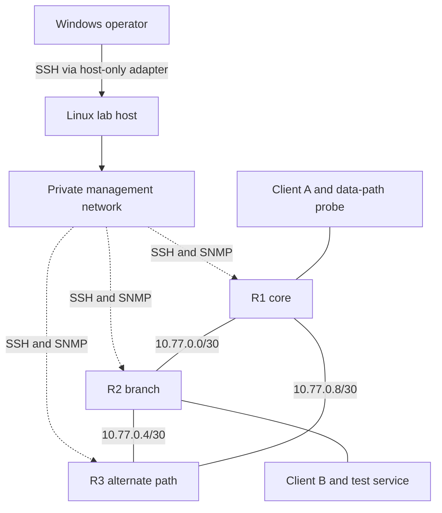

# Virtual network lab

The lab is the development and demonstration environment for the whole network operations platform. It provides real routing behavior, management interfaces, controlled traffic, and repeatable failures without depending on workplace equipment.

**Status:** design and build instructions. No VM, container image, topology, credential, or firewall rule has been created by this documentation work. Exact software pins will be selected and tested during T-003/T-004.

## Recommended host

Use a dedicated Linux VM on the Windows development computer. Start with a supported Ubuntu LTS release and Docker Engine inside the VM. Containerlab runs there and creates network nodes and links. Edit from Windows if convenient, but keep runtime volumes and private data on the Linux filesystem.

Containerlab documents Linux installation and Windows operation through WSL. A full VM is this project's preferred boundary because its networking and lifecycle can be managed separately. WSL2 is an alternative if VM access is unavailable, but its Windows/VPN routes and firewall behavior must be validated independently. [Installation](https://containerlab.dev/install/), [Windows instructions](https://containerlab.dev/windows/)

| Environment | Initial allocation estimate | Intended use |
| --- | --- | --- |
| Offline development | No lab VM required | Unit tests and fabricated config comparisons |
| One-router experiment | 2 vCPU, 4 GB RAM, 25 GB free guest disk | Capture/SSH validation |
| First integrated platform | 4 vCPU, 8 GB RAM, 50 GB free guest disk | Three FRR routers, two endpoints, monitoring stack |
| Expanded platform | 6–8 vCPU, 12–16 GB RAM, 80–100 GB free guest disk | API/database, logs, and topology; flow storage measured separately |

These are engineering estimates, not verified minimums. Keep memory and disk headroom for the Windows host. Flow analysis and Kubernetes may require separate profiles or a larger dedicated machine. Confirm actual capacity in F-01 before committing to a footprint.

Choose an already available supported hypervisor, such as Hyper-V where the Windows edition supports it, or the organization's approved alternative. No hypervisor installation is part of the present documentation change. A remote dedicated Linux host is also valid; a cloud host requires a budget, expiry/teardown plan, and equivalent isolation.

## Two distinct networks

**Management plane:** the collector reaches explicit router management IPs for SSH, SNMP, and health checks. Prometheus can scrape controlled exporters. Operators enter through an SSH connection to the VM and local port forwards.

**Data plane:** routers and endpoints communicate over Containerlab virtual Ethernet links. This is where routes, traffic, link failures, and endpoint outages are tested. It must have no bridge or uplink to the work network.

A healthy management address does not prove the data path works. The lab therefore includes a data-plane probe from an endpoint network as well as management reachability checks.

## Reference topology



The triangle supports route reconvergence experiments. Removing one transit link may reroute traffic successfully; it should not automatically be reported as a total network outage. Stopping R2 isolates its client subnet and provides a separate outage scenario.

## Proposed addressing

Check the selected ranges against Windows, VPN, VM, and Docker routes before use. These private addresses are examples, not guaranteed conflict-free allocations.

| Segment | Addresses | Purpose |
| --- | --- | --- |
| Container management | `172.31.250.0/24`; proposed gateway `.1` | Explicitly configured Containerlab management network |
| Router management | R1 `.11`, R2 `.12`, R3 `.13` in management subnet | Collection targets |
| Endpoint management | Client A `.21`, Client B `.22` in management subnet | Lab administration and probe scrape, if needed |
| R1–R2 | `10.77.0.0/30`; R1 `.1`, R2 `.2` | Transit link |
| R2–R3 | `10.77.0.4/30`; R2 `.5`, R3 `.6` | Transit link |
| R3–R1 | `10.77.0.8/30`; R3 `.9`, R1 `.10` | Transit link |
| Client A LAN | `10.77.10.0/24`; R1 `.1`, client `.10` | Synthetic source and data-plane probe |
| Client B LAN | `10.77.20.0/24`; R2 `.1`, client `.10` | Synthetic destination/test service |
| Router loopbacks | `10.77.255.1/32`, `.2/32`, `.3/32` | Stable routing identities |

Start with static routes in the one-router experiment if needed. Use OSPF across the three transit links for the integrated topology, advertise client networks/loopbacks, and exclude management interfaces from the routing domain. Do not redistribute the Docker management/default route into OSPF.

## Node capability contract

FRR's Linux container model gives us routing, not a complete managed appliance. The stock image is not assumed to provide SSH, SNMP, LLDP, restricted users, or all desired tooling. The project must deliberately supply and validate these interfaces. Containerlab's [FRR example](https://containerlab.dev/lab-examples/frr01/) is a topology reference, not a ready-made secure device image.

| Interface | Implementation work | Proof required |
| --- | --- | --- |
| Routing | Pinned FRR image/build with required daemons and lab configuration | Expected routes and endpoint connectivity |
| Configuration read | OpenSSH service plus a restricted account and fixed wrapper around an approved FRR read command | Remote result matches console reference; unsupported commands denied |
| SNMP | Explicit agent configuration and generated lab credentials | Known IF-MIB OIDs work; missing objects remain unavailable |
| LLDP | Later add supported LLDP collection, potentially `lldpd` | Observations match Containerlab links and expire appropriately |
| Flow export | Later select an exporter that sees the intended data-plane interface | Collector sees controlled traffic with known sampling and timeout settings |

FRR's `vtysh` reads the live daemon state and participates in integrated configuration handling. Access to it can also enable configuration changes; ordinary shell or daemon-socket access must not be described as read-only. Test the wrapper and actual account privileges. [FRR VTY shell](https://docs.frrouting.org/en/latest/vtysh.html)

The candidate fixed capture operation is `vtysh -c 'show running-config'`, subject to validation against the selected image and daemon set. The SSH wrapper must permit only that read operation, not arbitrary `vtysh` arguments or an unrestricted shell. Its transport behavior must also work with the chosen SSH adapter.

This captures FRR's routing configuration. It does not archive the entire Linux node, SSH/SNMP settings, host networking, or Containerlab topology. Versioned lab definitions own those other inputs. Record this capture scope in adapter metadata and do not describe an FRR snapshot as a complete appliance backup.

## Build sequence

### 1. Confirm the host and routes — T-003

Record hypervisor, guest release, architecture, vCPU, RAM, free disk, and routes. In the Linux guest, these read-only commands support the inventory once the guest exists:

```bash
uname -a
cat /etc/os-release
free -h
df -h
ip -brief address
ip route
```

Record capacity without copying workplace routes or host identifiers into public evidence. Confirm the lab address plan has no overlap with the relevant networks.

### 2. Establish isolation before nodes — T-003/T-004

Use a host-only/internal virtual switch for operator access. A temporary NAT adapter may be used for downloads, then disconnected for isolated fault experiments. If continued internet access is required, explicitly constrain it and prove that workplace/private destinations are denied. NAT by itself allows outbound traffic.

At the VM and container forwarding boundary, default-deny unintended egress and allow only the required management paths. Handle IPv6 explicitly: isolate it with equivalent rules or disable it in this lab profile. Keep router data links entirely inside the VM. Never attach a Containerlab link to a physical NIC or corporate bridge in the default profile.

Test isolation with an owned sentinel outside the lab, packet observation, route inspection, and connection attempts to explicitly approved test endpoints. Do not scan the workplace to prove isolation. Record the expected denied flows and actual results.

Docker programs packet-filtering rules, and published container traffic can bypass expectations based only on UFW. Inspect effective Docker/host behavior and the firewall backend in use. Do not disable Docker's rule management as a shortcut. [Docker firewall documentation](https://docs.docker.com/engine/network/packet-filtering-firewalls/)

### 3. Install and record the runtime — T-004

Use the official Docker Engine and Containerlab instructions for the chosen guest release. Select tested versions, verify published integrity information where available, and record versions before building images. Avoid blindly running an unreviewed download script with administrator privileges.

After installation, record:

```bash
docker version
docker compose version
containerlab version
```

Containerlab requires privileged networking operations. Keep those privileges inside the dedicated lab VM; the application collector does not receive access to the Docker socket or host administrator credentials.

### 4. Build one managed router — T-004

Create a reproducible image with the FRR daemons, required SSH service, and a tested capture wrapper. Generate host keys and lab client credentials locally. Store no fixed private keys or reusable passwords in image layers or Git. Define health checks and startup ordering so SSH success is not mistaken for FRR readiness.

Create the first topology under the planned `lab/topologies/` directory and pin its image. Test console routing state, SSH host-key enrollment, the permitted command, and rejected write/shell operations. Capture a manual reference through a separate operator path.

### 5. Prove the application path — T-007/T-009

Connect the collector through the same SSH interface a later device adapter will use. A host `docker exec` capture can help debugging, but does not prove the SSH requirement. Capture a baseline, make a controlled lab-only description or route change through operator credentials, and capture again.

### 6. Expand the topology — T-010

Add R2/R3 and the two endpoints, configure data links and routing, and deploy management telemetry. Test both management reachability and Client A → Client B data-plane connectivity. Implement the data-plane probe in Client A's network context, with a scrape path reachable only from the monitoring stack.

Keep the Linux forwarding/sysctl choices, namespace permissions, interface mapping, and daemon config in versioned templates. Rebuild from scratch to prove the definitions are complete.

### 7. Add monitoring services — T-011 through T-014

Use Compose for Prometheus, Grafana, exporters, Alertmanager, and a local test receiver. Explicitly join collectors to the approved management network; Compose's default network is not automatically the Containerlab network. Reserve addresses or use validated service discovery to avoid conflicts.

Publish UI ports only to VM loopback and reach them by SSH tunnel. Restrict exporter endpoints: an unrestricted multi-target exporter could probe arbitrary destinations. Keep collection credentials in mounted runtime secret files with appropriate permissions.

### 8. Run the integrated scenarios — T-015

Follow [test scenarios](test-scenarios.md). Record actual outputs, image digests, resource use, and recovery behavior. The first usable release requires a fresh lab rebuild plus a working configuration-change and outage/alert/recovery demonstration.

## Service reachability plan

| Source | Destination | Protocol | Purpose |
| --- | --- | --- | --- |
| Operator | Lab VM management interface | SSH TCP 22 | Administration and local forwarding |
| Collector | Explicit router management IPs | SSH TCP 22 | Configuration read |
| SNMP exporter | Approved agent IPs | UDP 161 | Authenticated SNMP polling, preferably v3 authPriv |
| Blackbox/data-path probe | Explicit lab endpoints | ICMP or selected TCP service | Management and routed-path health |
| Prometheus | Exporters and application metrics | Internal HTTP, configured ports | Telemetry scraping |
| Grafana | Prometheus | Internal HTTP | Dashboard queries |
| Alertmanager | Local test receiver | Internal HTTP | Test notifications |
| Later lab nodes | Syslog/flow collector | Explicitly selected ports/protocols | Event and traffic experiments |

No UI or database should bind broadly on the Windows/workplace network. Use the implemented service configuration as the authoritative port list and test it after each networking change.

## Lifecycle and evidence

Future lifecycle commands will use the actual committed topology filename, for example Containerlab's deploy/inspect/destroy operations. Do not publish pretend copy-and-paste project commands until those files exist and the commands have been tested.

For teardown, stop schedules, preserve required synthetic evidence, destroy only the named lab, and verify its containers/links are gone. Do not use global Docker prune or delete persistent snapshot/database volumes as a routine stop operation. Rebuild credentials as needed and explicitly re-enroll changed host keys after verifying their identity.

The lab proves this implementation against specified virtual images and sizes. It does not validate all vendor devices, physical forwarding capacity, workplace routing, or production load. Those require separate evidence.
