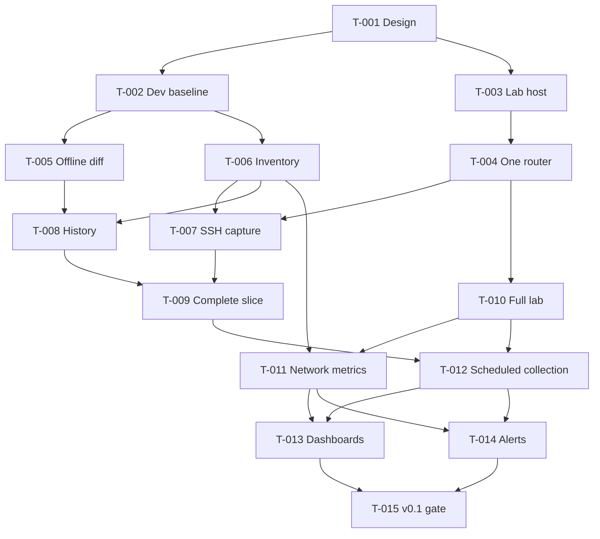
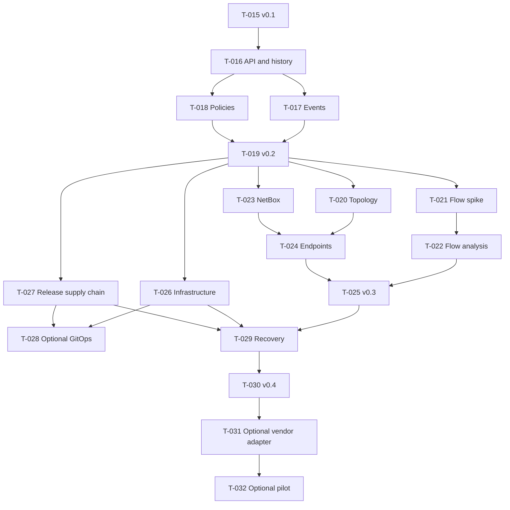

# Roadmap and dependency map

This is the authoritative work plan. It adapts the supplied spreadsheet's requirements, priorities, dependencies, and time estimates into a GitHub-readable plan with stable IDs and explicit completion evidence.

**Baseline:** 2026-09-28. **Owner:** Corbin de Blois. **Capacity:** not yet agreed. Effort means focused development hours for one person, including relevant testing and documentation. Ranges are planning assumptions, not deadlines or measured productivity. Learning, interruptions, and environment troubleshooting can extend elapsed time.

## How to select the next task

`Done` means its evidence exists and was checked. `In progress` means work has started but completion evidence is not yet complete. `Ready` means all predecessors are done. `Planned` means not started and at least one predecessor remains. Optional work also needs an explicit decision to enter scope. Dependencies mean **all listed predecessors** must finish; they are not alternatives.

Within the earliest incomplete release, choose a ready task. Prefer the task that unblocks the most required downstream work. Keep IDs stable when priorities change. Record actual effort and evidence when closing a task. Do not start a downstream implementation just because its estimated date has arrived.

## Release gates

| Gate | Product result | Required evidence |
| --- | --- | --- |
| Foundation | One-router capture/validation/storage/diff path | T-009; a complete engineering slice, not a product release |
| v0.1.0 | Integrated inventory, configuration history, health, dashboards, and alerts | T-015; FR-01–FR-16 and QR-01–QR-06 |
| v0.2.0 | API, event investigation, policy checks | T-019; FR-17–FR-19 and QR-07 |
| v0.3.0 | Topology, traffic, address/inventory, endpoint visibility | T-025; FR-20–FR-23 |
| v0.4.0 | Reproducible infrastructure and operational release | T-030; FR-24 and QR-08; FR-25 only if selected |
| Optional workplace pilot | A measured, authorized read-only canary | T-032; FR-26 and production gate |

## Foundation and first platform release

T-002 has established the repository name and initial Git baseline. Python packaging, dependency locks, offline tests, CI, and the license decision remain. Its estimate still describes the full task; actual effort will be recorded at completion.

| ID | Deliverable and completion evidence | Direct predecessors | Hours | Status |
| --- | --- | --- | --- | --- |
| T-001 | Project documentation baseline; coherent scope, source links, dependency map, lab design | None | — | Done |
| T-002 | Git/Python baseline, chosen package name, uv lockfile, Ruff/pytest, CI checks, license decision before an open-source release; clean offline test run | T-001 | 3–5 | In progress |
| T-003 | Host capacity, hypervisor/runtime plan, address overlap review, isolation design and host checks recorded | T-001 | 3–6 | Ready |
| T-004 | One pinned FRR lab image and topology with verified SSH read wrapper, generated secrets, and isolation evidence | T-003 | 6–10 | Planned |
| T-005 | Synthetic comparison fixtures and offline command path; known-change, no-change, invalid-input tests | T-002 | 4–6 | Planned |
| T-006 | Inventory schema, stable IDs, target allowlist, credential references, and path/command-injection rejection tests | T-002 | 3–5 | Planned |
| T-007 | SSH adapter, strict host keys, capture validation, timeouts and classified failures; matches manual router capture | T-004, T-006 | 5–9 | Planned |
| T-008 | Immutable snapshots, versioned normalization, locks and baseline recovery; storage/interruption tests | T-005, T-006 | 5–8 | Planned |
| T-009 | One-router end-to-end capture/diff proof; verify capture and error contracts against the lab | T-007, T-008 | 4–7 | Planned |
| T-010 | Three routers/two endpoints, routed-path probe, telemetry-capable nodes, and clean topology rebuild | T-004 | 5–9 | Planned |
| T-011 | Prometheus/exporters with management/data-path probes and supported SNMP metrics; freshness/missing-data tests | T-006, T-010 | 6–10 | Planned |
| T-012 | Multi-device scheduling, bounded concurrency, safe summaries, restart behavior and stale-capture metrics | T-009, T-010 | 5–8 | Planned |
| T-013 | Provisioned Grafana overview and device dashboards combining network and capture health | T-011, T-012 | 4–7 | Planned |
| T-014 | Alert rules/local receiver with outage, recovery, deduplication, silence, and collector-failure evidence | T-011, T-012 | 4–7 | Planned |
| T-015 | v0.1 clean-room setup, integrated scenario, resource measurements, README usage, runbook, reviewed demo | T-013, T-014 | 5–8 | Planned |

This graph shows prerequisites, not parallel staffing. One developer still performs all required work. A calendar critical path cannot be asserted until resource availability and task durations are established.

## Investigation and network intelligence

| ID | Deliverable and completion evidence | Direct predecessors | Hours | Status |
| --- | --- | --- | --- | --- |
| T-016 | PostgreSQL metadata, migrations/restore, FastAPI read contract, authentication and per-device authorization | T-015 | 12–20 | Planned |
| T-017 | Lab syslog pipeline and time/identity correlation with uncertainty clearly presented | T-016 | 6–10 | Planned |
| T-018 | Three versioned lab policies with pass/fail/unknown and adverse-input tests | T-016 | 5–8 | Planned |
| T-019 | v0.2 incident walkthrough, API/authorization tests and restored-database evidence | T-017, T-018 | 4–7 | Planned |
| T-020 | LLDP collection and intended-versus-observed topology with stale/missing-neighbor handling | T-019 | 8–14 | Planned |
| T-021 | Flow feasibility experiment: choose exporter/protocol/collector/storage and measure footprint | T-019 | 4–8 | Planned |
| T-022 | Flow ingest and top-conversation view with controlled-traffic reconciliation and retention | T-021 | 10–18 | Planned |
| T-023 | Read-only NetBox integration and address/inventory discrepancy checks | T-019 | 8–14 | Planned |
| T-024 | Synthetic endpoint-to-port mapping with ambiguity and stale-observation tests | T-020, T-023 | 8–14 | Planned |
| T-025 | v0.3 topology, flow, inventory and endpoint demo with compatibility/accuracy limitations | T-022, T-024 | 5–8 | Planned |

## Platform delivery and optional pilot

| ID | Deliverable and completion evidence | Direct predecessors | Hours | Status |
| --- | --- | --- | --- | --- |
| T-026 | Repeatable host/service setup with Ansible and suitable infrastructure provisioning; private state and idempotency checks | T-019 | 8–14 | Planned |
| T-027 | Application release image, pinned delivery inputs, dependency inventory, vulnerability review and provenance | T-019 | 6–10 | Planned |
| T-028 | Optional kind/Argo CD deployment, readiness, storage, networking and rollback demonstration | T-026, T-027 | 10–18 | Optional |
| T-029 | Recovery rehearsal, retention validation, platform self-observability and measured operating targets | T-025, T-026, T-027 | 8–14 | Planned |
| T-030 | v0.4 clean deployment/restore demonstration and final operating guide; include T-028 evidence if that option was selected | T-029 | 5–8 | Planned |
| T-031 | Optional approved workplace platform/image adapter and representative non-production validation | T-030 | 6–12 | Optional |
| T-032 | Optional production gate, one-device canary, measured impact, rollback and pilot report | T-031 | 4–8 | Optional |

T-028 is not a mandatory predecessor of T-030 because Kubernetes is optional. If selected, add T-028 as a direct predecessor of T-030 before scheduling that release. Host/service automation can begin after v0.2 while network-intelligence work proceeds; the v0.4 gate still requires the integrated platform evidence.

## Planning discipline

The first usable release requires all T-002 through T-015, not just the longest dependency chain. Their current ranges sum to **62–105 focused hours**. The core plan through T-030 totals **159–272 hours**, excluding completed documentation, optional Kubernetes work, and the optional workplace pilot. T-028 adds 10–18 hours if selected; T-031/T-032 add 10–20 hours. These are rough estimates with substantial uncertainty, especially before the lab and flow experiments.

Recalculate totals when task ranges change. At the first implementation checkpoint, agree hours per week and translate effort into a provisional calendar with explicit contingency. Do not borrow the supplied workbook's four-person schedule or its time estimates for this one-person project.

For each task, record: owner, actual start/finish, actual focused hours, commit/PR reference, acceptance evidence, limitations, and newly ready successors. Use task IDs in GitHub issue titles. No issues have been created as part of this baseline; reference actual issue numbers only after they exist.

## Definition of done

A task is done when its intended behavior or artifact is present, its relevant acceptance/failure checks pass, public material contains no operational secrets, and affected requirements/decisions/runbooks/status are updated. An implemented path without a verified failure case is not sufficient for a reliability requirement.

If a predecessor fails, keep dependent tasks planned and record the specific blocker. Continue independent ready work, such as offline comparison while the VM is being resolved. Scope changes require corresponding requirement, dependency, and estimate updates.
